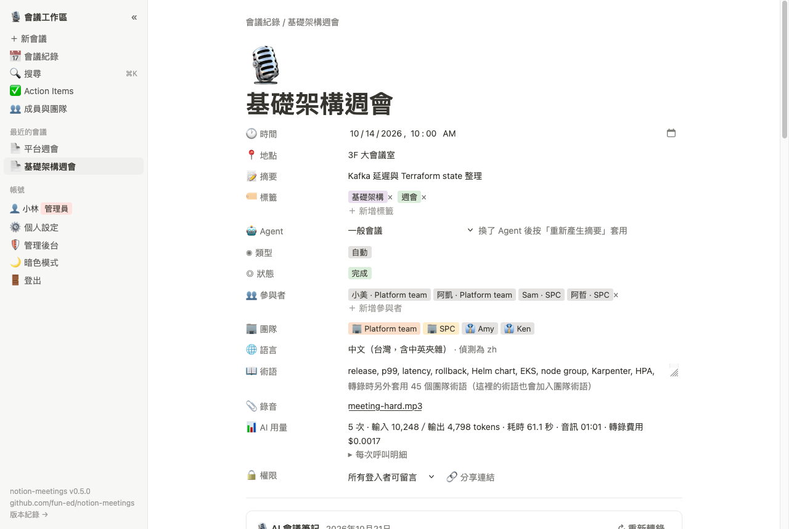
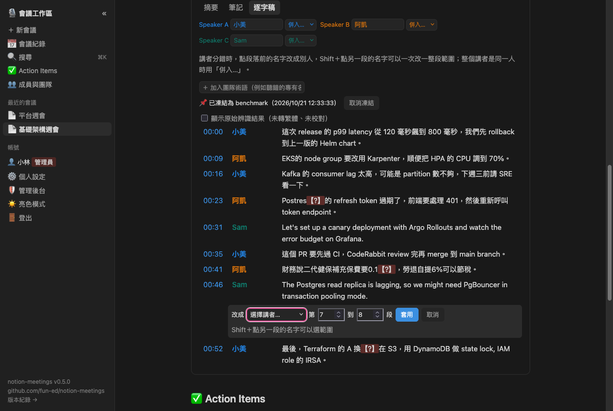
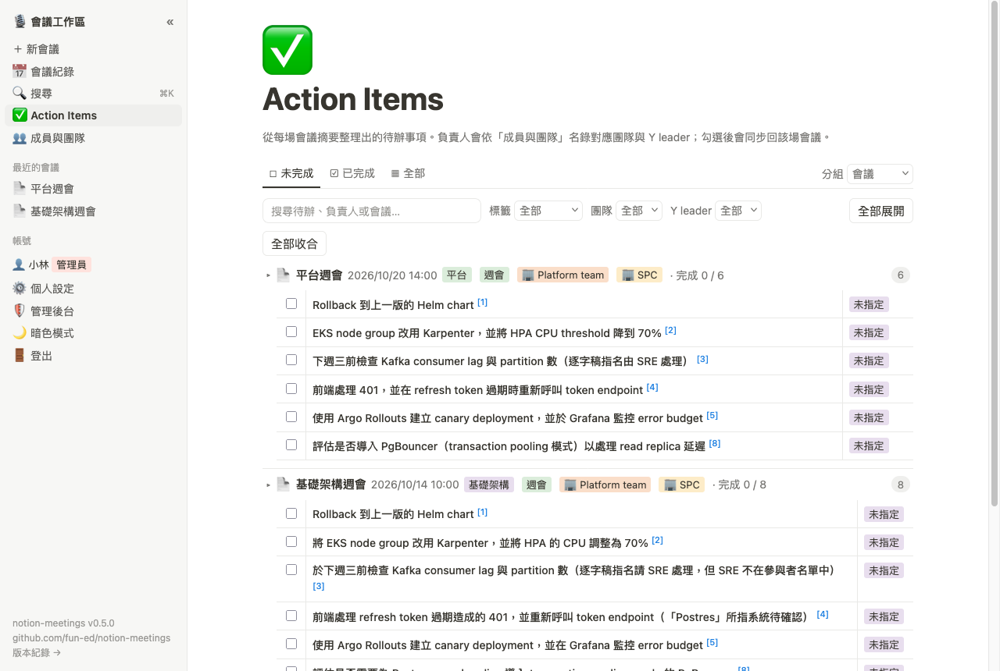

# notion-meetings

[English](README.md) | 繁體中文

Notion AI Meeting Notes 的本機復刻。錄音或上傳會議檔案後，會產生分講者的台灣繁體逐字稿，中英夾雜的專業術語也能正確辨識，再由 Claude 寫出摘要與待辦事項。

下載：<https://github.com/fun-ed/notion-meetings/releases> · 變更紀錄：[CHANGELOG.md](CHANGELOG.md)



## 功能

- 麥克風錄音，或上傳音訊、影片（mp4、mov、m4a、mp3、wav、webm）。原始檔案會保存，可以下載。
- 轉錄流程：經 OpenRouter 呼叫 MAI-Transcribe 2（零資料保留），用 OpenCC 轉成台灣用詞，再由 Claude 只修正這場會議術語表裡的詞。不確定的地方標成【?】，並保留原始辨識結果。
- 校正講者：可以改講者名字、把一段或一整段範圍改給別人、合併兩位講者，也能加入沒發言的參與者。
- 學習迴圈：會議的術語自動累積成團隊術語，每場轉錄都會套用；中文逐字稿出現韓文或日文假名時標【?】；Claude 依點名線索（「謝謝 X」）建議講者是誰，按一下套用；校正好的會議可以凍結成 benchmark，追蹤講者正確率與 CER。
- 摘要可選 Agent，例如 DRI 交接、架構討論、EKS 升級、CI/CD、各類 design review。每個重點都標出依據的逐字稿行號。
- 跨會議的 Action Items，可依會議、團隊、負責人或 Y leader 分組。
- 搜尋簡繁互通，支援 `tag:`、`who:`、`team:`、`after:` 等篩選。
- 帳號分管理員、成員、唯讀；每場會議可設權限，也能建立可撤銷的分享連結並留言。
- 每次 AI 呼叫都記錄用量（tokens、音訊秒數、費用、耗時）。有亮色與暗色模式，時間一律是台灣時間（GMT+8）。





## 需要的環境

| 項目 | 說明 |
|---|---|
| ffmpeg | 要在 `PATH` 上（`brew install ffmpeg`、`apt install ffmpeg`） |
| OpenRouter 金鑰 | 轉錄必備 |
| Claude | 設定 `ANTHROPIC_API_KEY`，或用 `ANTHROPIC_BASE_URL` 指向 gateway |
| Node.js | 只有從原始碼執行時需要 |

OpenRouter 金鑰存在專案外、只有自己能讀的檔案（zsh 語法）：

```bash
read -s "K?OpenRouter key: " && mkdir -p ~/.config/openrouter && printf %s "$K" > ~/.config/openrouter/key && chmod 600 ~/.config/openrouter/key && unset K
```

設定 `OPENROUTER_API_KEY` 時會優先使用它。建議在 OpenRouter 為這把金鑰設定 Guardrail：只允許 `microsoft/mai-transcribe-2`，並開啟零資料保留。

## 執行

使用 Release 的執行檔（macOS、Linux、Windows）：

```bash
ANTHROPIC_API_KEY=... ./notion-meetings-v<版本>-darwin-arm64
```

macOS 下載後，第一次要先執行 `xattr -d com.apple.quarantine <檔案>`。資料存在 `~/.notion-meetings`。

從原始碼執行：

```bash
mise exec -- npm install
mise exec -- npm start              # Anthropic API（ANTHROPIC_API_KEY）
mise exec -- npm run start:magpie   # 本機 magpie gateway（127.0.0.1:3425）
```

開啟 <http://localhost:3000>。第一個建立的帳號是管理員。

| 環境變數 | 預設值 | 用途 |
|---|---|---|
| `PORT` | `3000` | 伺服器埠號 |
| `DATA_DIR` | `./data`（執行檔：`~/.notion-meetings`） | 會議、帳號、名錄與模型設定 |
| `OPENROUTER_API_KEY` | `~/.config/openrouter/key` | 轉錄金鑰 |
| `ANTHROPIC_BASE_URL`、`ANTHROPIC_API_KEY` | Anthropic API | Anthropic 模型的預設端點與金鑰 |
| `OPENAI_BASE_URL`、`OPENAI_API_KEY` | — | OpenAI 相容模型（例如 LiteLLM）的預設端點與金鑰 |

管理員在「管理後台 › 模型」設定 LLM。每個模型有 provider、LLM Endpoint 與 API key：

- **OpenAI 相容**（建議）：公司的 LiteLLM、magpie 或 OpenAI，例如 `https://litellm.example.com/v1`。可以按「讀取模型」從端點挑選模型 ID。
- **Anthropic**：原生 Anthropic API。

API key 在後台輸入一次，只存在這台 Mac 的 `data/secrets.json`（權限 600）。同一個端點的模型共用，介面只顯示末四碼；也可以改填環境變數名稱。術語校對與講者建議可以各自指定模型。內建的設定有 Claude Opus 5.5（預設）、Sonnet 5.5、GPT-6.1 Sol、GPT-6 Luna。

## 搜尋語法

| 寫法 | 找到的會議 |
|---|---|
| `kafka 延遲` | 兩個詞都有出現 |
| `"consumer lag"` | 完整片語 |
| `tag:平台`、`type:站立` | 標籤、摘要類型 |
| `who:小美`、`team:SPC`、`leader:Ken`、`group:ZTSA` | 講者或待辦負責人，依人、團隊、Y leader 或群組 |
| `after:2026-10-01`、`before:2026-10-31` | 會議日期範圍，含當天 |

## 資料與隱私

- 伺服器只接受 `127.0.0.1` 的連線。它沒有 HTTPS，不要開放到網路上。
- 音訊送到 OpenRouter 的零資料保留端點；逐字稿文字與 Agent 的 skill 送到你設定的 LLM 端點，建議用公司的 LiteLLM。
- 錄音時的即時字幕預設關閉。開啟後只用瀏覽器的本機語音辨識，不會改用雲端服務。
- `data/` 不進 git。每場會議存在 `data/<YYYY-MM-DD>/<id>/`，內容是原始錄音與 `meeting.json`。團隊術語與 benchmark 結果存在各自 Mac 的 `data/learned.json`。
- 密碼用 scrypt 雜湊。登入狀態是 HttpOnly cookie，存在伺服器記憶體，重新啟動後要重新登入。

## 開發

```bash
mise exec -- npm test        # 單元與 API 測試，不呼叫外部服務
mise exec -- npm run build   # 用 Bun 在 dist/ 產生單一執行檔
```

處理流程的回歸測試（`eval/e2e.py`）和執行檔的發版檢查（`scripts/smoke-binary.sh`）會呼叫真的 API，步驟寫在 `meetings-dev` skill。

| 路徑 | 內容 |
|---|---|
| [docs/decisions.md](docs/decisions.md) | 決策與理由，改程式前先讀 |
| [docs/architecture.md](docs/architecture.md) | 處理流程、資料欄位、API |
| [docs/plans/](docs/plans/) | 計畫，檔名是 `YYYY-MM-DD-<主題>.md` |
| [docs/research/](docs/research/) | 轉錄模型評測 |
| `.claude/skills/meetings-dev` | 開發、測試、建置與發版 |
| `.claude/skills/stt-research` | 評估新的轉錄模型 |
