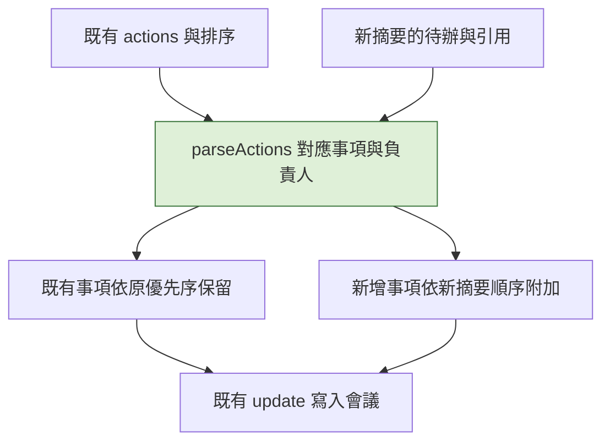

# 計畫：摘要更新後保留待辦優先順序

## 目標

會議底部已支援拖曳與上下移動，並將優先順序儲存為 `actions` 陣列順序。本次更新讓重新產生摘要時，相同待辦繼續保留既有順序與完成狀態，同時採用新摘要的引用；新增待辦接在最後，已移除的待辦不重新出現。分類沿用 `owner`／`done`，不新增 category 或 priority 欄位。

## 流程

## 範圍與分類

- Core：`parseActions()` 由摘要處理與舊會議讀取共用；API、權限及儲存格式不變。
- 修改 `server.js`、`server.test.js`、`public/index.html` 的操作說明，以及 README、架構文件與變更紀錄。
- 保留工作目錄內尚未提交的 UI、測試及合成截圖變更，不重構其他流程。
- 不改私人術語資料、模型、提示詞、轉錄流程或相依套件；不 commit、push 或發版。

## 對應規則

1. 以事項文字及負責人精確對應，沿用既有粗體標記移除與首尾空白整理，不做模糊語意比對。
2. 相同事項與負責人重複時，先以仍相同的引用區分；引用已變更則依出現順序逐筆對應，避免一筆完成狀態套用到全部重複項目。
3. 對應成功的待辦依既有陣列順序排列，沿用已完成狀態；引用一律取自新摘要。
4. 新事項或負責人已改變的事項視為新增，接在保留事項之後；新事項彼此沿用摘要順序。
5. 新摘要已移除的事項不保留。沒有舊事項時維持既有解析順序。
6. 舊資料若沒有負責人欄位，保留原本依文字繼承完成狀態的相容行為，不推測其優先序。

## 驗證

- 單元測試：舊順序與新摘要順序不同時仍保留優先序，引用更新、完成狀態保留、新增／刪除／改負責人及重複事項各自正確。
- 執行 `mise exec -- npm test`，包含現有拖曳、收合、權限與跨會議切換測試。
- 以隔離的暫存資料及合成音檔執行 `eval/e2e.py`，確認摘要處理回歸。此項不代表本機 150 詞試行清單的辨識品質評測。
- 檢查操作說明、README、架構文件與程式一致，並執行 `git diff --check`。

## 風險與回復

- 模型若改寫事項文字或負責人，無法可靠判定同一事項，會作為新待辦附加；不以猜測繼承完成狀態。
- 不新增儲存欄位或遷移資料。回復此次解析邏輯即可恢復原本摘要順序；既有 UI 與資料仍可讀取。

## 執行狀態

- [x] 已建立計畫，依使用者「建立 plan 然後更新」要求接續實作。
- [x] 解析邏輯與回歸測試完成；完整測試 61 項全過。
- [x] 介面及文件同步。
- [x] 驗證結果記錄完成。

## 驗證結果

- `mise exec -- npm test`：61 項全過。新測試直接核對優先序、完成狀態、新引用、新增／移除／更換負責人，以及重複事項的逐筆對應。
- `eval/e2e.py`：隔離資料的乾淨與嚴苛合成音檔均 PASS，術語各 45/45、0 簡體、講者一致性 9/9、講者分離 3/3，兩場均完成摘要與待辦解析。
- 合成回歸確認處理流程；更新摘要後的排序對照由單元測試驗證。這些結果不代表本機 150 詞清單的辨識品質評測。
- 人工檢視兩場摘要，仍有 HPA 動詞及嚴苛音檔的語句被標為待確認；沒有調低驗收門檻。
